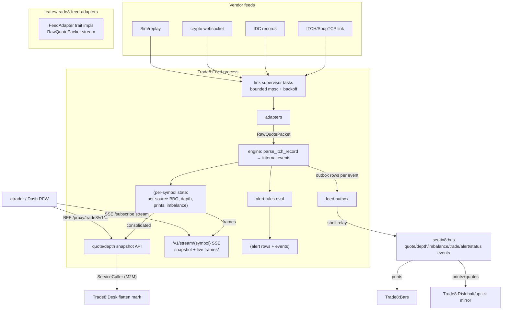

# Trade8:Feed - Market Data Service

> Audience: anyone evaluating or onboarding to the service. For the
> wire-level construction read `DESIGN.md`; for business functionality read
> `BUSINESS.md`. Vertical context: the top-level `DESIGN.md`

> (system map) and `BUSINESS.md` (business view).

## 1. Summary

Trade8:Feed is the market-data tier: it ingests vendor quotes through
**pluggable adapters** (ITCH, IDC, crypto websocket, FIX-MD, simulation),
normalizes them into one internal event shape (L1 BBO, L2 depth, auction
imbalance, trade prints), applies per-user entitlement gating, and fans out
to clients through BFF SSE subscriptions - plus declarative price alerts
(evaluated in-process, persisted, and pushed). It is the source of prints
for Trade8:Bars, the halt/uptick mirror for Trade8:Risk, and the BBO
snapshot source for Desk's flatten pricing.

## 2. Motivation

Vendor market data is inherently messy - every vendor has its own wire
format, sequence semantics, and quirks - while consumers (Risk, Bars, apps)
need one pristine, sequenced, entitlement-gated stream. Feeding those
consumers directly from vendor daemons couples them to vendor formats and
loses consolidation. Feed solves it with an adapter boundary:

- **Adapters are pluggable codecs** behind one trait; vendor differences
  stay in `crates/feed-adapters`, which parse/convert vendor packets into
  raw records - the engine never sees vendor bytes.
- **Consolidation is an engine concern**: BBO merges across sources
  (best bid = max across sources, best ask = min, sizes summed at the
  extremes) - the NBBO-style consolidated quote is what apps and Risk see,
  with per-source detail retained.
- **Entitlements at the boundary**: L1/L2/TOS data types are separate
  Shield actions, checked at subscribe time - no partial data leaks to a
  subscriber lacking depth rights.
- **Alerts live at the firehose**: evaluating rules in-process on the quote
  path gives sub-second alerting without polling loops.

## 3. Architecture & High-Level Design

## 4. Key Traits and Data Structures

- **`FeedState`** - shell core + `FeedEngine` + SSE broadcast channel.
- **`FeedEngine`** (`core.rs`) - per-symbol `SymbolQuotes` (consolidated L1
  + per-source BBO, prints tape, L2 `DepthState`, imbalance), the vendor
  symbol directory (`SymbolDirectory` → (symbol_id, price_scale)), source
  mapping, alert rules; `ingest_packet` → normalized `TradeEvent`s;
  snapshot readers (`quote_snapshot`, `depth_snapshot`, imbalance/tape).
- **`AlertRule`** (`core.rs`) - declarative rule (symbol, op gt/lt/gte/lte,
  threshold); `matches` evaluates on the last print; admin CRUD +
  fired-alert persistence + ack.
- **Adapter boundary** (`trade8::feed_adapters`) - `FeedAdapter` trait
  (kind/connect/stream), `AdapterKind` registry (`adapter_for`), raw packet
  → `RawRecord` parsing (BBO/Level/Print/Imbalance).
- **`store`** - feed links (secret-ref credentials), quote sources, alert
  rules + fired alerts (with ack), feed-status rows, outbox events
  (`quote:updated`, `trade:printed`, `depth:updated`, `imbalance:updated`,
  `alert:fired`, `feed:status`).
- **Contracts** - `trade8::contracts::marketdata.{QuoteUpdate, DepthUpdate,
  ImbalanceUpdate, TradePrint, AlertFired, FeedStatus, FeedState}`.

## 5. Rationale, Trade-offs, and Alternatives

- **Adapter trait + registry rather than vendor modules in the engine.**
  New vendors are new crates/rows, not engine changes; the sim adapter
  drives demos/tests deterministically. Rejected: per-vendor ingestion
  branches in the engine (unbounded growth, untestable).
- **In-process alert matching rather than a rules service.** Alerts are
  latency-sensitive and stateless per print; the engine already owns the
  firehose. Complex/tenant-authored conditions delegate to Sentin8:Func
  (`on_quote` hook). Rejected: a polling rules worker (latency, extra load).
- **SSE (one-way tier) rather than WebSocket for market data.** Quotes flow
  server→client only; `/ws` is reserved for order entry (platform transport
  tiers). Snapshot-then-live framing supports cold start and resync.
- **Per-topic SSE sequences with client gap detection** - the app
  resync-requests a snapshot on gap; the server stream stays stateless per
  connection.
- **Entitlements as Shield actions**, not per-vendor ACLs: L1/L2/imbalance/
  history map to discrete actions (`trade8:feed:{quote,depth}:read`,
  `trade8:feed:manage`, `trade8:feed:history:read` for the app's history
  tier) decided by the policy engine at subscribe/read time.
- **Mimalloc allocator** (master design §11) for the quote path.

## 6. Internal Implementation & Invariants (Private Design)

**Invariants** (unit + `tests/`):

- Adapters never touch the engine's internals; the only ingest surface is
  `RawQuotePacket` → `ingest_packet` → event list (pure, deterministic,
  unit-tested without tokio).
- The consolidated BBO is computed from per-source quotes - a single-source
  symbol's BBO is that source's quote; multi-source merges max-bid/min-ask
  with summed sizes at the extremes.
- Alert evaluation is pure (`AlertRule::matches`) and stateless per print;
  a fired alert persists + emits exactly once per trigger, with an
  acknowledge trail (`ack_by`/`ack_at`).
- Fired-alert fan-out frames ride the same broadcast channel as quotes
  (prefixed per symbol); the SSE stream filters frames per symbol so
  subscribers see only their symbol.
- Feed-status classification is silence-based (5s degraded / 30s dead while
  enabled) on the per-source seq monitor; every transition persists +
  emits `feed:status`.
- Secrets: `credentials_ref` only - vendor credentials are never stored
  inline; the adapter's `run` receives resolved credentials.
- RLS context + explicit env filters on every query; the outbox row rides
  every market-data event (payload-complete so printers/bars/risk never
  call back).

## 7. Unresolved Questions / Future Designs

- **FIX-MD adapter** - `adapter_for(FixMd)` currently maps to the sim
  adapter (interim); the FIX market-data client (MBO/MBP subscription) is
  the remaining adapter work.
- **Symbol directory seeding** - the engine's symbol directory loads
  vendor-symbol mappings at boot from the link config; auto-discovery from
  vendor symbol directories is open.
- **Imbalance snapshot API** - imbalance state is normalized and stored;
  the dedicated REST snapshot endpoint is not routable yet (SSE-only).
- **MoldUDP / multicast ingress** - out of scope by design; a tenant
  needing wire multicast is a venue-facing (exchange8) concern.
- **Alert window conditions** (`window_ms` confirm windows) - schema
  carries them; in-process evaluation currently matches immediately.

---

**Architecture & Design:** trade8:feed and its underlying concepts were designed by [Hamid Jahanzad](https://www.linkedin.com/in/hamidjahanzad/).
